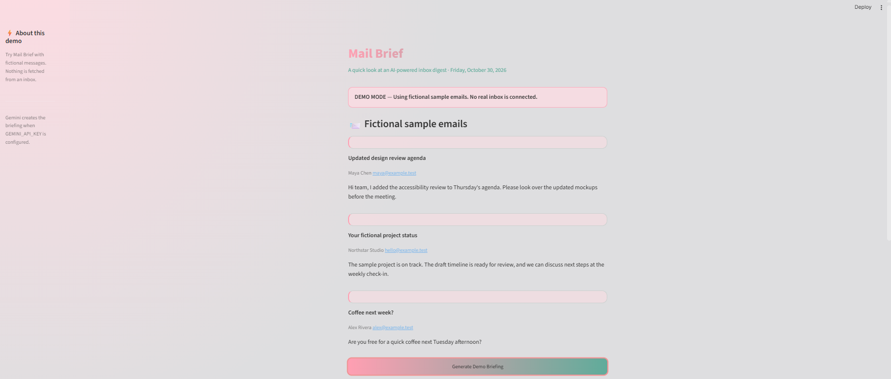
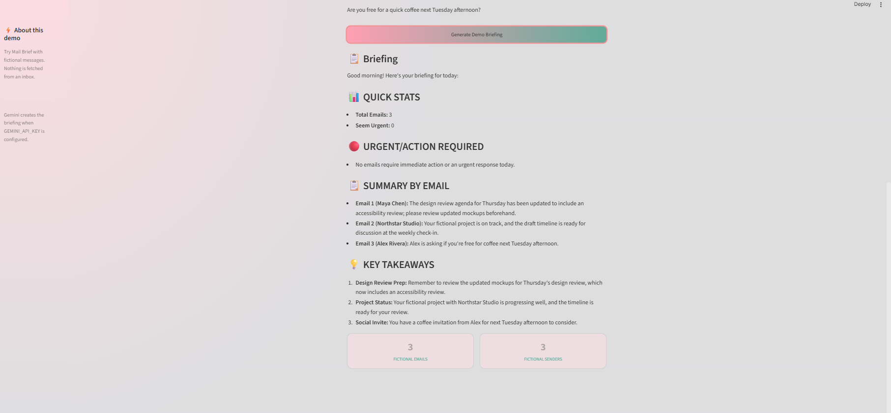

# Mail Brief

An AI agent that reads today's emails, flags the urgent ones, and gives you a quick morning briefing, so you don't have to open every message.




## Features
- Reads messages from the current day in Pakistan time.
- Requests Gmail read-only access.
- Summarizes messages with Gemini (`gemini-2.5-flash`) and flags urgent emails.
- Shows a briefing and individual email previews in a Streamlit interface.
- Handles missing email fields and nested MIME message parts.

## Two ways to run it
- `demo_app.py`: a public demo with **fictional** sample emails. It does not connect to Gmail.
- `app.py`: the original app that connects to your own Gmail.

## Run the fictional demo
```bash
streamlit run demo_app.py
```
Gemini is optional. To generate a live briefing, set `GEMINI_API_KEY` in your environment or a local `.env` file (start from `.env.example`). Never commit the real key. Without a key, the demo shows a clearly labeled sample briefing.

## Run the Gmail app
(keep your existing Requirements, Setup, and OAuth steps here)

```bash
streamlit run app.py
```

## Run tests
```bash
python -m unittest discover -s tests -v
```

## Privacy and secrets
Keep `.env`, `credentials.json`, and `token.json` private. The app requests read-only Gmail access.

## Current scope
Built for local use with one Gmail account. Not yet a public service.

## Roadmap
- Mark emails as read (planned)